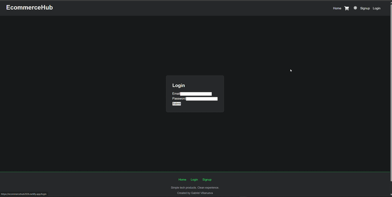

# Personal Project *Ecommerce Hub*

Created by: **Gabriel Villanueva**

# Link to Live Project

[Click here](https://ecommercehub2026.netlify.app/)

**Ecommerce Hub** is a web application where users can look through a catalog of products, choose which to add to cart, and manipulate quantities and totals at the cart. There is also login/signup functionality implemented using supabase database. The final page of the app, is a demo order where the app returns the confirmed order as a browser alert.

## Tech Stack

- Frontend: React, JavaScript, HTML, CSS, Vite
- Authentication: Supabase Auth
- Product Data: DummyJSON REST API
- Deployment: Netlify
- Version Control: Git and Github

## Features

The following functionality is completed:

* [x] A card grid displaying backend product data such as images, product title, price and product description.
* [x] A navigation bar where users are able to access light/dark mode, cart, return to home, or move to signup/login pages.
* [x] A cart page where users are able to view items that are in cart, their respective price and quantity. A cart summary also displays similar data but also including a order total section where shipping and tax are included.
* [x] A checkout page where the order summary is displayed with items and their quantities, a total amount in US dollar, a disclaimer demo message and a button where the user can place a sample order.
* [x] A footer that is fixed to the bottom of the screen where users can access the same navigation links as the navigation bar, a small company message and a real gmail to contact me.
* [x] Shopping cart persistence using localStorage

## Video Walkthrough

Here's a walkthrough of implemented features:

gif created using *ezgif.com*

## Notes

One of the main challenges was implementing user authentication with Supabase and ensuring the signup and login processes worked correctly.

Another challenge involved managing shopping cart state and creating a responsive layout that displays product cards and cart information consistently across different screen sizes.

Working through these challenges helped strengthen my understanding of React state management, API integration, authentication, and responsive web design.
